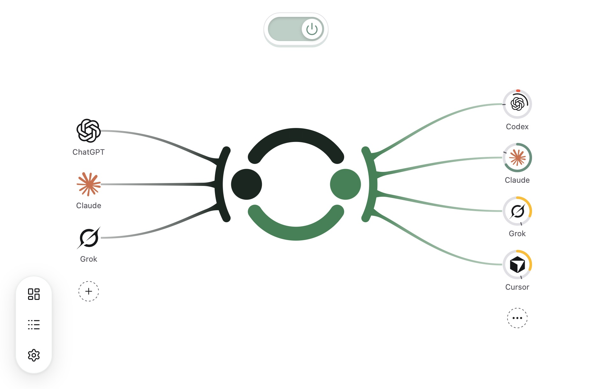

# Agent Remote Control (ARC)

**Plan in Claude. Let local Codex execute. Close the loop without relaying messages yourself.**

**English** | [简体中文](README.zh-CN.md)

https://github.com/user-attachments/assets/bc58f15f-4d6e-4a0c-a78f-a7661e1ccf33

*30-second intro · sound on.*

[Download ARC](https://github.com/whzxc/agent-remote-control/releases) · [Getting started](docs/getting-started.md) · [Documentation](#documentation)

## Claude + Codex: the Loop

Discuss and plan in a Claude Code session on claude.ai, accessible from the web, phone, or desktop app. Through ARC, Claude reads current files, Git changes, and Codex tasks, then sends a concrete job to Codex on your computer. After verifying notification delivery with a code received in that session, Claude can end its turn after dispatch; ARC’s notification brings it back to review and continue. Until then, follow the receipt’s revisit or wait guidance.

Connect Claude with a remote link and approve it locally. Automatic follow-ups additionally need the initiating Claude Code cloud session ID and a signed-in local Claude Code CLI. [Set up the Loop](docs/guides/claude.md).

## ChatGPT Chat + Codex

GPT-6 Astra Pro is available in ChatGPT Chat mode, but not in Codex. ARC connects them: Chat handles deep reasoning, and Codex executes. Use a ChatGPT Pro, Business, or Enterprise account with that option enabled. A remote link with local approval is the default connection. [Connect ChatGPT](docs/guides/chatgpt.md).

Explore the ARC app

## Get started

[Install ARC](docs/installation.md), open it, sign in to Codex, and choose where to use it.

- **Local mode:** choose **On this computer**. ARC adds an installed Claude Code automatically. For Claude Desktop, click **Install extension**, then restart Claude.
- **Create a relay:** choose **On your phone and the web → Create my relay**, sign in to a free Cloudflare account, and wait for the remote link.
- **Shared relay:** choose **Have a shared link?** and paste it. The deployer only sees a computer list in ARC, but can technically inspect relayed traffic in the Cloudflare dashboard. Only join someone you trust.

### Add a control source in three steps

1. Choose Claude, ChatGPT, or another control source and copy the remote link.
2. Follow the panel’s path to add the link in that control source’s settings.
3. Return to ARC, compare the four-character pairing codes in your browser and approval card, and approve.

Copy the suggested prompt to have Codex reply “Connected.” [Step-by-step guide](docs/getting-started.md). Own addresses and OpenAI Secure Tunnel are under **Remote link → Advanced**.

For help from a local Agent with installation or setup:

> Set up Agent Remote Control on this computer. Follow https://raw.githubusercontent.com/whzxc/agent-remote-control/main/skills/arc-setup/SKILL.md

## Documentation

- **Start:** [Getting started](docs/getting-started.md) · [Concepts](docs/concepts.md) · [Automatic setup](docs/auto-setup.md)
- **Connect:** [Claude](docs/guides/claude.md) · [ChatGPT](docs/guides/chatgpt.md) · [Other clients](docs/guides/other-clients.md) · [HTTPS providers](docs/guides/connections.md)
- **Use:** [FAQ](docs/faq.md) · [Install, update, uninstall](docs/installation.md) · [Why ARC](docs/story.md)
- **Reference (English):** [Tools](docs/reference/tools.md) · [Agents](docs/reference/agents.md) · [CLI](docs/reference/cli.md) · [OAuth](docs/reference/oauth.md) · [Subscriptions](docs/reference/subscriptions.md) · [Linux](docs/reference/linux.md)
- **Contribute (中文):** [Development](docs/dev/development.md) · [Architecture](docs/dev/architecture.md) · [UI](docs/dev/ui.md) · [Releases](docs/dev/release.md)

Also supports Notion, Slack, Cursor, GitHub Copilot, Raycast, Microsoft Copilot, Grok and custom MCP clients; Antigravity, Pi, OpenCode and other ACP Agents run alongside Codex.

Local ChatGPT Desktop panels live in the independent [Usage](https://github.com/whzxc/chatgpt-usage-plugin) and [Kanban](https://github.com/whzxc/chatgpt-kanban-plugin) plugin repositories.

## License

[MIT](LICENSE).
