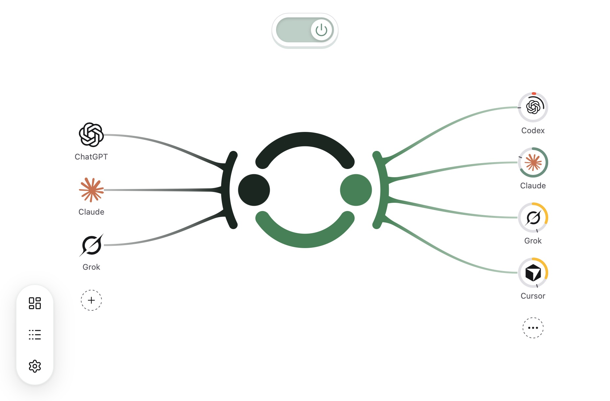

# Agent Remote Control（ARC）

**在 Claude 里规划，让本机 Codex 执行，自动接回结果，不用自己来回传话。**

[English](README.md) | **简体中文**

全新 Mac 上，把这句话交给本机 Agent，即可从安装开始配置 ARC：

> 在这台电脑上配置 Agent Remote Control，按照 https://raw.githubusercontent.com/whzxc/agent-remote-control/main/skills/arc-setup/SKILL.md 操作。

已经安装？在 App 中点击**添加控制源 → 发送给 Codex**。[其他安装方式](docs/zh-CN/installation.md)。



```text
控制源                        你的电脑                        Agents
Claude -- HTTPS + OAuth --+                               +-- Codex
                          +-- ARC -- live project facts --+
ChatGPT - Secure Tunnel --+                               +-- Pi / ACP

Codex 轮次结束 -> ARC -> 绑定的 Claude Code 云端会话
```

## Claude + Codex：协作闭环（Loop）

在 claude.ai 的 Claude Code 会话里讨论和规划，网页、手机和桌面 App 都能打开。Claude 通过 ARC 读取当前文件、Git 改动和 Codex 任务，再把明确的工作派给本机 Codex。派发后 Claude 可以直接结束本轮；Codex 完成时，ARC 的通知会唤醒同一云端会话，让 Claude 审查改动并继续。离开键盘，也能继续推进。

Claude 使用 HTTPS + OAuth 接入。自动回访还需要发起方的 Claude Code 云端会话 ID，以及本机已登录的 Claude Code CLI。[建立闭环](docs/zh-CN/guides/claude.md)。

## ChatGPT Chat + Codex

GPT-6 Astra Pro 在 ChatGPT Chat 模式里可用，Codex 里没有。ARC 把两者接起来：Chat 负责深度推理，Codex 负责执行。使用已开放该选项的 ChatGPT Pro、Business 或 Enterprise 账号，默认通过 OpenAI Secure Tunnel 连接。[接入 ChatGPT](docs/zh-CN/guides/chatgpt.md)。

## 三步开始

1. **安装。** 从 [Releases](https://github.com/whzxc/agent-remote-control/releases) 下载最新的 macOS 应用，移入 Applications，并登录 Codex。[安装说明](docs/zh-CN/installation.md)。
2. **接入 Claude。** 在 ARC 选择添加控制源 → 手动配置 → Claude，再选择 HTTPS + OAuth，把 MCP URL 添加为 Claude 自定义连接器，再到 ARC 同意授权。
3. **派出首个任务。** 告诉 Claude：“通过 ARC 让 Codex 不读文件、不调用工具，只回复 ARC_LOOP_OK。设置 notify 为 {channel: "claude-session", target: 你自己的 Claude Code 云端会话 ID 或 URL}。派发后结束本轮，收到通知再读取结果。”若 Claude 无法读取自身会话 ID，再手动粘贴云端会话 URL 或 ID。[逐步上手](docs/zh-CN/getting-started.md)。

## 文档

- **开始：**[上手](docs/zh-CN/getting-started.md) · [概念](docs/zh-CN/concepts.md) · [自动配置](docs/zh-CN/auto-setup.md)
- **连接：**[Claude](docs/zh-CN/guides/claude.md) · [ChatGPT](docs/zh-CN/guides/chatgpt.md) · [其他客户端](docs/zh-CN/guides/other-clients.md) · [HTTPS 提供商](docs/zh-CN/guides/connections.md)
- **使用：**[常见问题](docs/zh-CN/faq.md) · [安装、更新、卸载](docs/zh-CN/installation.md) · [为什么做 ARC](docs/zh-CN/story.md)
- **参考（英文）：**[工具](docs/reference/tools.md) · [Agents](docs/reference/agents.md) · [CLI](docs/reference/cli.md) · [OAuth](docs/reference/oauth.md) · [订阅额度](docs/reference/subscriptions.md) · [Linux](docs/reference/linux.md)
- **维护：**[开发](docs/dev/development.md) · [架构](docs/dev/architecture.md) · [UI](docs/dev/ui.md) · [发布](docs/dev/release.md)

也支持 Notion、Slack、Cursor、GitHub Copilot、Raycast、Microsoft Copilot、Grok 和自定义 MCP 客户端；Pi、OpenCode 与其他 ACP Agent 可与 Codex 一起使用。

本机 ChatGPT Desktop 面板由独立的 [Usage](https://github.com/whzxc/chatgpt-usage-plugin) 和 [Kanban](https://github.com/whzxc/chatgpt-kanban-plugin) 插件仓库维护。

## 许可证

[MIT](LICENSE)。
